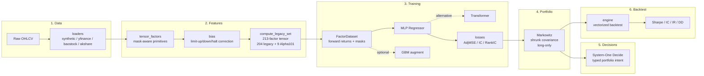

# ml-quant-trading

**A reproducible PyTorch research stack for cross-sectional factor research:
213 mask-aware factors, public-data validation, cost-aware backtests, auditable
reports, and a preview typed portfolio-decision adapter.**

[](https://github.com/initial-d/ml-quant-trading/actions/workflows/ci.yml)
[](https://github.com/initial-d/ml-quant-trading/stargazers)
[](https://github.com/initial-d/ml-quant-trading/releases)
[](https://pypi.org/project/mlquantx/)
[](https://arxiv.org/abs/2507.07107)
[](https://github.com/initial-d/dsh-plugin-mlquant-benchmark)
[](https://www.python.org/downloads/)
[](LICENSE)

Languages: [English](README.md) | [简体中文](README.zh-CN.md) | [繁體中文](README.zh-TW.md)

[**Run in Colab**](https://colab.research.google.com/github/initial-d/ml-quant-trading/blob/main/notebooks/quickstart_colab.ipynb)
· [**Project Facts**](docs/answer_index.md)
· [**How to Cite**](docs/citation_conversion.md)
· [**Agent Benchmark Challenge**](docs/agent_quant_benchmark_challenge.md)
· [**Validation Dashboard**](docs/validation_dashboard.md)
· [**Benchmark Board**](docs/benchmark_board.md)
· [**Share This Project**](docs/share_this_project.md)
· [**Run with DSH**](docs/deepseek_harness_recipe.md)
· [**Decision Adapter**](docs/systemone_adapter.md)
· [**Quant Jev Article**](docs/article_zh_quant_jev_portfolio_decision.md)
· [**Read the Paper**](https://arxiv.org/abs/2507.07107)

## Quick Start

```bash
python -m pip install mlquantx
mlquant demo
```

No market-data account or API key is required. The deterministic demo runs the
full research pipeline in about 30-90 seconds on a typical CPU-only laptop and
writes shareable Markdown and JSON reports under `artifacts/small/`.

**Returning after an earlier release?** Upgrade with
`python -m pip install --upgrade mlquantx`. The
[`v0.4.1` release](https://github.com/initial-d/ml-quant-trading/releases/tag/v0.4.1)
masks limit-move observations before rolling factors and measures returns across
zero-filled halts from the last tradable close. Version `v0.4.0` also moved demo
evaluation to a held-out chronological window and made public-data dependencies
optional. Install `python -m pip install --upgrade 'mlquantx[data]'` for public
loaders; re-run older A-share or halt-bearing reports. These are correctness
changes, not new trading-performance evidence.

```text
data -> masks -> 213 factors -> model scores -> portfolio weights -> cost-aware backtest
```

Typical successful output includes:

```text
wrote artifacts/small/panel.pt  (500 dates x 200 stocks)
wrote features: torch.Size([500, 200, 213])
wrote predictions: torch.Size([500, 200])
wrote weights: (500, 200)

Backtest summary
```

For development:

```bash
git clone https://github.com/initial-d/ml-quant-trading.git
cd ml-quant-trading
python -m pip install -e '.[dev]'
python -m pytest
```

Once it runs, you can [inspect the benchmark](docs/benchmark_board.md) or
[share a reproduction report](https://github.com/initial-d/ml-quant-trading/issues/new?template=reproduction_report.yml).
If the baseline is useful, a Star helps other researchers find it.
Evaluating privately? Use the
[private evaluation checklist](docs/private_evaluation_checklist.md) or submit a
[redacted evaluation note](https://github.com/initial-d/ml-quant-trading/issues/new?template=private_evaluation_note.yml)
without exposing proprietary data, positions, or strategy details. For public
reports, follow the [reproducibility contract](docs/reproducibility_contract.md)
so results remain auditable after the original run.

| 213 factors | 4 data paths | 100+ tests | CPU/GPU benchmark |
|---:|---:|---:|---:|
| Mask-aware PyTorch tensors | Synthetic, AkShare, Baostock, yfinance | Deterministic engineering checks | Reproducible across machines |

See the [benchmark board](docs/benchmark_board.md) for complete environments,
commands, and raw results. Cross-machine snapshots are reported separately and
are not presented as controlled hardware rankings.

## Why This Repository?

`ml-quant-trading` is a reproducible quant research baseline, not a live
trading system. It gives students, researchers, engineers, and agent harnesses a
concrete way to inspect and extend a full factor-to-backtest workflow:

| You get | Why it matters |
|---|---|
| **213 factor dimensions** | Mask-aware PyTorch factors with documented families and tensor primitives |
| **One end-to-end path** | Data, masks, factors, models, portfolio construction, cost-aware backtest, and reports |
| **Mask-first factor protocol** | Non-tradable limit-move observations are masked before rolling-window factors, not only filtered later |
| **Public and synthetic data paths** | Start without private data, then test AkShare, Baostock, or yfinance |
| **Evidence, including failures** | Costs, turnover, baselines, caveats, and negative or blocked runs stay visible |
| **A contribution path** | CI, tests, report templates, Colab, and newcomer-sized research tasks |
| **Typed portfolio-decision adapter** | Pipeline state can also be exposed as bounded portfolio intent, without turning the project into execution infrastructure |

If you are citing the paper, the most specific contribution is the mask-first
factor-computation protocol: non-tradable limit-move prices should be masked
before rolling-window factors so they do not contaminate downstream signals. See
the [citation conversion guide](docs/citation_conversion.md).

Try the live Hugging Face artifacts: the
[100,000-row synthetic dataset](https://huggingface.co/datasets/dddyym/ml-quant-trading-synthetic)
and [213-input MLP checkpoint](https://huggingface.co/dddyym/ml-quant-trading-synthetic-mlp).
Both come from the deterministic quick start and explicitly exclude real and
proprietary market data; see the [artifact guide](docs/huggingface_artifacts.md).

Ready to modify factors, models, data sources, or backtest assumptions? Install
from a source checkout:

```bash
git clone https://github.com/initial-d/ml-quant-trading.git
cd ml-quant-trading
python -m pip install -e '.[dev]'
```

## Fast Path

| If you want to... | Start here | What you get |
|---|---|---|
| See the project run | [`mlquant demo`](#quick-start) | A 30-90 second synthetic end-to-end smoke test |
| Use portfolio decisions | [System-One Adapter](docs/systemone_adapter.md) | Typed `asset_action`, `target_weight`, `trade_allowed`, `risk_bucket`, and participation answers |
| Understand the quant Jev-style framing | [Chinese portfolio-decision article](docs/article_zh_quant_jev_portfolio_decision.md) | Why the pipeline itself can be exposed as a typed decision surface |
| Summarize or cite the project | [Project Facts](docs/answer_index.md) | Canonical facts, links, evidence boundaries, and citation context |
| Cite the paper precisely | [Citation Conversion Guide](docs/citation_conversion.md) | A reusable citation sentence, BibTeX, related-work hooks, and claim boundaries |
| Audit implementation semantics | [Six Pipeline Invariants](docs/article_en_six_pipeline_invariants.md) | A deterministic check of factors, masks, labels, timing, and cost arithmetic |
| Understand the claims | [Research Card](docs/research_card.md) | Intended use, non-goals, validation status, and data caveats |
| Try public data | [Public-Data Mini Reproduction](docs/public_data_mini_reproduction.md) | A small yfinance factor-IC check with documented outputs |
| Run a larger validation | [Public-Data Validation](docs/public_data_validation.md) | Walk-forward baselines, costs, turnover, bootstrap CIs, and report artifacts |
| Run A-share validation | [AkShare CSI 300 Report](docs/validation_akshare_csi300_20260729.md) | Zero-auth A-share validation on the current CSI 300 public universe |
| Run paper-style public validation | [AkShare CSI 300 Daily 213-Factor Report](docs/validation_akshare_csi300_full_pipeline_20260729.md) | Daily 213-factor public-data approximation with turnover control |
| Test a coding or quant agent | [Agent Quant Benchmark Challenge](docs/agent_quant_benchmark_challenge.md) | A zero-account challenge for agent reproducibility, evidence preservation, and caveat discipline |
| Use DeepSeek Harness | [DeepSeek Harness Recipe](docs/deepseek_harness_recipe.md) | Agent-ready benchmark and validation workflows without adding an agent runtime dependency |
| Evaluate privately | [Private Evaluation Checklist](docs/private_evaluation_checklist.md) | A redaction-safe way to record private or institutional runs |
| Submit auditable evidence | [Reproducibility Contract](docs/reproducibility_contract.md) | Minimum fields, data fingerprints, artifact checksums, and tolerance rules |
| Share the project | [Share This Project](docs/share_this_project.md) | Copy-ready language that keeps claims bounded |

## Validation Dashboard

Archived public-data snapshot (2026-07-29, before v0.4.1):
[AkShare CSI 300 Daily 213-Factor Validation](docs/validation_dashboard.md).

**The numbers below predate the v0.4.1 mask-first and halt-safe return fixes.**
They remain historical records and have not been revalidated with the corrected
protocol. The [October 17 audit](docs/audits/public-revalidation-20261017/README.md)
also found next-day availability entering portfolio selection through v0.4.1;
revalidation requires that correction too. The detailed
dashboard includes the protocol note, cost-sensitivity charts, and reproduction
commands.

| Run | Universe | Frequency | Factor set | Main result at 7 bps effective cost |
|---|---|---:|---:|---|
| Daily 213-factor public approximation | Current CSI 300, 2021-01-04 to 2024-12-31 | Daily | 213 | Buffered factor portfolio: 22.20% ann. return, 0.919 Sharpe, 2.1616 final equity |
| Equal-weight baseline | Same panel | Daily | n/a | 17.75% ann. return, 0.882 Sharpe, 1.8744 final equity |
| Naive daily factor selection | Same panel | Daily | 213 | Positive gross edge, but high turnover reduces net performance |

Strategy table from that archived snapshot:

| Strategy | Annual return | Sharpe | Max drawdown | Turnover | Cost drag | Final equity |
|---|---:|---:|---:|---:|---:|---:|
| `equal_weight_daily` | 17.75% | 0.882 | 25.76% | 0.0010 | 0.13% | 1.8744 |
| `factor_mean_daily` | 15.80% | 0.701 | 32.51% | 0.3627 | 49.16% | 1.7579 |
| `factor_mean_buffered_daily` | 22.20% | 0.919 | 27.76% | 0.1397 | 18.94% | 2.1616 |

The useful takeaway is framework-level: factor scores need tradability, turnover,
and cost-aware portfolio construction before public-data backtests are
interpreted. This is a public-data approximation using current CSI 300
constituents, not an exact paper reproduction or investment claim.

Acknowledgement: the AkShare zero-auth A-share data path was added through
contributor work from [@redamancy231-create](https://github.com/redamancy231-create)
in [PR #42](https://github.com/initial-d/ml-quant-trading/pull/42).

## Community Evidence

Independent results are linked to pull requests, issues, or discussions so the
environment, commands, limitations, and review history remain inspectable.

| External contribution | What it added |
|---|---|
| [PR #18](https://github.com/initial-d/ml-quant-trading/pull/18) | ETF cross-asset public-data reproduction |
| [PR #34](https://github.com/initial-d/ml-quant-trading/pull/34) | Windows/Baostock A-share validation on 25 stocks |
| [PR #35](https://github.com/initial-d/ml-quant-trading/pull/35) | Neutralization and Baostock robustness fixes |
| [PR #36](https://github.com/initial-d/ml-quant-trading/pull/36) | English handbook for all factor families |
| [PR #42](https://github.com/initial-d/ml-quant-trading/pull/42) | Zero-account AkShare loader enabling CSI 300 validation |
| [PR #47](https://github.com/initial-d/ml-quant-trading/pull/47) | Clarified cumulative cost-drag units across code, reports, tests, and documentation |
| [Issue #59](https://github.com/initial-d/ml-quant-trading/issues/59) | Community Apple M4 protocol v1 CPU benchmark with raw caveats preserved |
| [DSH benchmark report #61](https://github.com/initial-d/ml-quant-trading/issues/61) | Seed DeepSeek Harness benchmark report with prompt, environment, artifact, and caveats |
| [Agent Quant Benchmark Challenge #66](https://github.com/initial-d/ml-quant-trading/discussions/66) | Challenge thread for coding agents, quant agents, DSH runs, and redacted private evaluations |
| [Issue #67](https://github.com/initial-d/ml-quant-trading/issues/67) | Community Windows CPU protocol v1 benchmark, archived on the benchmark board |
| [PR #68](https://github.com/initial-d/ml-quant-trading/pull/68) | Masked tensor factor regression coverage from a first-time contributor |
| [Awesome AI Trading Research review](https://github.com/ohselab/awesome-ai-trading-research/issues/1#issuecomment-5406093265) | Full-text curated-list evaluation: A-tier listing, with reproducibility and cross-market caveats |

This repository is validation-first: simple baselines, transaction costs,
public-data failure modes, and negative results are documented alongside the
research pipeline. Successful and failed runs are both useful when the command,
environment, data source, and limitations are preserved.

Want to add another machine, universe, or provider route? Run the
[zero-account Colab](https://colab.research.google.com/github/initial-d/ml-quant-trading/blob/main/notebooks/quickstart_colab.ipynb),
then submit the generated report through the
[structured form](https://github.com/initial-d/ml-quant-trading/issues/new?template=reproduction_report.yml).

DeepSeek Harness users can install the
[optional benchmark plugin](https://github.com/initial-d/dsh-plugin-mlquant-benchmark),
which is listed in
[Awesome DSH Plugin](https://awesome-dsh-plugin.com/#development--runtime), then
submit a structured
[DSH benchmark report](https://github.com/initial-d/ml-quant-trading/issues/new?template=deepseek_harness_benchmark.yml).

**Other current calls for contributors**

- Try the [`v0.4.1` release](https://github.com/initial-d/ml-quant-trading/releases/tag/v0.4.1).
- Read the [Research Card](docs/research_card.md) for intended use, current evidence, and non-goals.
- Read the [public-data mini reproduction](docs/public_data_mini_reproduction.md).
- Share benchmark or public-data results in [Discussions #13](https://github.com/initial-d/ml-quant-trading/discussions/13).
- Join the [Agent Quant Benchmark Challenge](https://github.com/initial-d/ml-quant-trading/discussions/66) with a coding agent, quant agent, DSH run, or redacted private evaluation.
- Pick up a newcomer task: [more benchmark reports](https://github.com/initial-d/ml-quant-trading/issues/7) or a [paired public-data validation or benchmark contribution](https://github.com/initial-d/ml-quant-trading/issues/22).
- Read the [Reality Check and Validation Status](docs/reality_check.md) before interpreting any backtest as evidence of deployable alpha.

## Core Modules

| Module | What it does |
|---|---|
| `mlquant.data` | Panel dataclass, synthetic generator, yfinance, Baostock, and AkShare loaders |
| `mlquant.features.tensor_factors` | Mask-aware PyTorch primitives such as rank, corr, ewma, and `ts_*` |
| `mlquant.features.legacy_factors` | 204 hand-crafted alpha factors with English and Chinese handbook coverage |
| `mlquant.features.alpha101` | Curated Alpha101-style formulaic factors |
| `mlquant.features.neutralize` | Cross-sectional and industry neutralization |
| `mlquant.features.bias` | Limit-up, limit-down, halt, and tradability bias correction |
| `mlquant.training` | Factor dataset, augmentation, and trainer |
| `mlquant.models` | MLP, Transformer, AdjMSE, IC, and RankIC losses |
| `mlquant.portfolio` | Long-only Markowitz-style construction with shrunk covariance support |
| `mlquant.backtest` | Vectorized backtest, Sharpe, IC, IR, and drawdown metrics |
| `mlquant.systemone` | Typed portfolio-intent decisions from structured pipeline state |

## Data Sources

| Source | Market | Access | Notes |
|---|---|---|---|
| Synthetic | N/A | Zero-config | Deterministic GBM panel for smoke tests and CI |
| [AkShare](https://akshare.akfamily.xyz/) | A-shares | Public, no API key | Zero-auth loader backed by public upstream interfaces that may change or rate-limit |
| [Baostock](http://baostock.com) | A-shares | Free registration | Supported A-share loader; requires account |
| [yfinance](https://pypi.org/project/yfinance/) | US equities / ETFs | Public, rate-limited | Used for public-data validation and cross-market examples |

The repository does not redistribute market data. AkShare, Baostock, and
yfinance data are downloaded on demand by the loader scripts. Public upstream
interfaces can change or rate-limit requests. Synthetic data is generated
deterministically from a fixed seed.

Example data loaders:

```python
from mlquant.data import make_panel

panel = make_panel(
    source="akshare",
    tickers=["600519", "000001"],
    start="2020-01-01",
    end="2023-12-31",
    adjust="qfq",
)
```

```python
from mlquant.data import make_panel

panel = make_panel(
    source="baostock",
    tickers=["sh.600000", "sz.000001"],
    start="2020-01-01",
    end="2023-12-31",
)
```

```python
from mlquant.data import make_panel

panel = make_panel(
    source="yfinance",
    tickers=["SPY", "QQQ", "IWM"],
    start="2020-01-01",
    end="2023-12-31",
)
```

## Installation And Demos

Install the published package:

```bash
python -m pip install mlquantx

# One-command smoke test: synthetic data, no API key required.
mlquant demo
```

The command prints a stage-by-stage run and writes shareable
`artifacts/small/summary.md` and `summary.json` reports alongside model and
backtest artifacts. The demo is a deterministic engineering smoke test, not a
performance claim.

Install from source for development or optional extras:

```bash
git clone https://github.com/initial-d/ml-quant-trading.git
cd ml-quant-trading
python -m pip install -e '.[dev]'  # add ,gpu for CUDA; add ,mosek for MOSEK solver
```

The public-data loaders (AkShare, Baostock, yfinance) live in the `data` extra:
`python -m pip install 'mlquantx[data]'`. The `dev` extra already includes it.

### Google Colab Quick Start

Run the deterministic end-to-end pipeline in Google Colab without a market-data
account or local setup:

[](https://colab.research.google.com/github/initial-d/ml-quant-trading/blob/main/notebooks/quickstart_colab.ipynb)

The account-based [Baostock A-share notebook](demo_baostock.ipynb) remains
available for users who want that data route.

### Public-Data Validation

For a lightweight public-data walkthrough, open
[`notebooks/public_factor_ic.ipynb`](notebooks/public_factor_ic.ipynb). It
downloads a small yfinance universe, computes a factor subset, and plots
one-day forward rank IC. If public data download fails, the notebook falls back
to the synthetic panel so the workflow remains runnable.

For a larger public-data validation run with walk-forward baselines, costs,
slippage, cost-sensitivity reports, optional bootstrap confidence intervals,
turnover, drawdown, and equal-weight / momentum / Alpha101 / MLP / Transformer
comparisons:

```bash
python scripts/public_data_validation.py \
  --source yfinance \
  --preset us-large-100 \
  --max-tickers 100
```

See [docs/public_data_validation.md](docs/public_data_validation.md). Treat
these runs as validation diagnostics, not trading recommendations. The script
writes `summary.md`, `summary.csv`, `summary.json`, `metadata.json`, and a
copy-ready `submission.md` for community reports. Add
`--cost-grid-bps 0,7,15,30` to generate `cost_sensitivity.*` files, and add
`--bootstrap-samples 500` to include return and Sharpe uncertainty intervals.
Maintainers can aggregate multiple `summary.json` files with
`scripts/aggregate_validation_reports.py` and audit individual reports with
`scripts/audit_validation_report.py`.

### Tensor Factor Benchmark

Canonical protocol v1 CPU benchmark:

```bash
python scripts/benchmark_tensor_factors.py \
  --device cpu --n-dates 750 --n-stocks 1000 --window 20 \
  --repeat 10 --warmup 3 --threads 1 --interop-threads 1 --seed 42 \
  --json-out artifacts/benchmark-v1.json
```

On systems with GNU Make:

```bash
make benchmark
```

See [docs/benchmarking.md](docs/benchmarking.md) for larger-panel commands and
reporting guidance. Benchmark reports from different machines are welcome
through the [`Benchmark result`](.github/ISSUE_TEMPLATE/benchmark_result.yml)
issue template. CPU/GPU benchmarks are engineering diagnostics, not trading
performance evidence.

### Reproducible Dev Environment

For a Docker-based CPU environment:

```bash
docker build -t ml-quant-trading .
docker run --rm ml-quant-trading make test
```

See [docs/docker.md](docs/docker.md) for Docker benchmark, synthetic pipeline,
and public-data validation commands.

For VS Code or GitHub Codespaces, use the included Dev Container:

```text
.devcontainer/devcontainer.json
```

It installs Python 3.11 and the project with `python -m pip install -e '.[dev]'`.

<details>
<summary><b>Documentation index</b></summary>

- [CHANGELOG.md](CHANGELOG.md) summarizes public releases.
- [docs/maintainer/](docs/maintainer/README.md) collects launch, outreach, and release-draft notes for maintainers.
- [docs/start_here.md](docs/start_here.md) gives new users a fast path through the project.
- [docs/research_card.md](docs/research_card.md) summarizes intended use, validation status, data assumptions, and known risks.
- [docs/reality_check.md](docs/reality_check.md) explains what is real, what is still a smoke test, and what is not claimed.
- [docs/systemone_adapter.md](docs/systemone_adapter.md) documents the System-One-compatible portfolio decision adapter.
- [docs/architecture.md](docs/architecture.md) shows the factor -> model -> portfolio -> backtest pipeline.
- [docs/faq.md](docs/faq.md) answers common setup, data, and reproducibility questions.
- [docs/docker.md](docs/docker.md) documents Docker and Dev Container setup.
- [docs/reproducibility_contract.md](docs/reproducibility_contract.md) defines minimum evidence fields for auditable reports.
- [docs/benchmark_board.md](docs/benchmark_board.md) tracks community benchmark reports.
- [docs/public_data_mini_reproduction.md](docs/public_data_mini_reproduction.md) records a small yfinance factor IC reproduction.
- [docs/public_data_validation.md](docs/public_data_validation.md) documents larger public-data walk-forward validation runs.
- [docs/validation_akshare_csi300_20260729.md](docs/validation_akshare_csi300_20260729.md) records the AkShare CSI 300 public A-share validation run for `v0.2.2`.
- [docs/validation_akshare_csi300_full_pipeline_20260729.md](docs/validation_akshare_csi300_full_pipeline_20260729.md) records the daily 213-factor AkShare CSI 300 public-data approximation.
- [docs/validation_digest_20260727.md](docs/validation_digest_20260727.md) summarizes the public validation and discovery surface for `v0.2.1`.
- [docs/share_this_project.md](docs/share_this_project.md) gives visitors short, safe sharing language.
- [docs/article_zh_213_factor_csi300.md](docs/article_zh_213_factor_csi300.md) is the long-form Chinese technical launch article.
- [docs/article_zh_quant_jev_portfolio_decision.md](docs/article_zh_quant_jev_portfolio_decision.md) explains the quant Jev-style portfolio decision surface in Chinese.
- [docs/community.md](docs/community.md) explains contribution lanes and maintainer response rules.
- [`v0.1.0`](https://github.com/initial-d/ml-quant-trading/releases/tag/v0.1.0) is the first public research baseline release.
- [`v0.2.0`](https://github.com/initial-d/ml-quant-trading/releases/tag/v0.2.0) is the public validation and contributor-workflow release.
- [`v0.2.1`](https://github.com/initial-d/ml-quant-trading/releases/tag/v0.2.1) is the validation entrypoint and outreach follow-through release.
- [`v0.2.2`](https://github.com/initial-d/ml-quant-trading/releases/tag/v0.2.2) is the AkShare public A-share validation release.
- [`v0.3.0`](https://github.com/initial-d/ml-quant-trading/releases/tag/v0.3.0) is the Agent Quant Benchmark Challenge release.
- [`v0.3.1`](https://github.com/initial-d/ml-quant-trading/releases/tag/v0.3.1) is the typed portfolio-decision adapter release.
- [`v0.4.0`](https://github.com/initial-d/ml-quant-trading/releases/tag/v0.4.0) is the out-of-sample evaluation and lighter-install release.
- [`v0.4.1`](https://github.com/initial-d/ml-quant-trading/releases/tag/v0.4.1) makes the CLI and validation scripts mask-first and returns halt-safe.
- [Benchmark and reproduction discussion](https://github.com/initial-d/ml-quant-trading/discussions/13) is open for community reports.

</details>

## Factor Library

The full feature set comprises **9 curated Alpha101 formulas**
(`features.alpha101`) plus **204 hand-crafted legacy factors**
(`features.legacy_factors`) for a total of **213 dimensions**. All factors are
mask-aware PyTorch tensors with signature `Panel -> (values[T,N], mask[T,N])`.

Factor handbook: [English](docs/factor_handbook_en.md) ·
[中文](docs/factor_handbook.md). The handbook records design notes and
implementation rationale for each factor family.

| Family | Count | Description |
|---|---:|---|
| `better_001` - `better_028` | 28 | VWAP deviation and volume-weighted momentum |
| `best_001` - `best_021` | 21 | Close-location momentum variants |
| `old_027` - `old_076` | 50 | Classic alpha signals, correlation/rank composites |
| `stock_001` - `stock_022` | 22 | Per-stock derived series: volume, range, and price |
| `extra_001` - `extra_014` | 14 | Turnover and amount features |
| `add_001` - `add_030` | 30 | Additional composite factors |
| `change_001` - `change_005` | 5 | Short-window change-of-velocity |
| `original_001` - `original_028` | 28 | Close/volume direct statistics |
| `cs_rank_*` | 6 | Market breadth and cross-sectional rank signals |

Usage:

```python
from mlquant.features import compute_legacy_set

# Compute all 213 factors: 204 legacy + 9 Alpha101.
factors, mask, names = compute_legacy_set(panel)  # -> [T, N, 213]

# Or compute a named subset.
factors, mask, names = compute_legacy_set(
    panel,
    names=("best_001", "add_015", "old_042"),
)
```

<details>
<summary><b>Full factor list</b></summary>

```text
add_001    add_002    add_003    add_004    add_005    add_006
add_007    add_008    add_009    add_010    add_011    add_012
add_013    add_014    add_015    add_016    add_017    add_018
add_019    add_020    add_021    add_022    add_023    add_024
add_025    add_026    add_027    add_028    add_029    add_030
best_001   best_002   best_003   best_004   best_005   best_006
best_007   best_008   best_009   best_010   best_011   best_012
best_013   best_014   best_015   best_016   best_017   best_018
best_019   best_020   best_021
change_001 change_002 change_003 change_004 change_005
extra_001  extra_002  extra_003  extra_004  extra_005  extra_006
extra_007  extra_008  extra_009  extra_010  extra_011  extra_012
extra_013  extra_014
old_027    old_028    old_029    old_030    old_031    old_032
old_033    old_034    old_035    old_036    old_037    old_038
old_039    old_040    old_041    old_042    old_043    old_044
old_045    old_046    old_047    old_048    old_049    old_050
old_051    old_052    old_053    old_054    old_055    old_056
old_057    old_058    old_059    old_060    old_061    old_062
old_063    old_064    old_065    old_066    old_067    old_068
old_069    old_070    old_071    old_072    old_073    old_074
old_075    old_076
original_001 original_002 original_003 original_004 original_005
original_006 original_007 original_008 original_009 original_010
original_011 original_012 original_013 original_014 original_015
original_016 original_017 original_018 original_019 original_020
original_021 original_022 original_023 original_024 original_025
original_026 original_027 original_028
stock_001  stock_002  stock_003  stock_004  stock_005  stock_006
stock_007  stock_008  stock_009  stock_010  stock_011  stock_012
stock_013  stock_014  stock_015  stock_016  stock_017  stock_018
stock_019  stock_020  stock_021  stock_022
```

</details>

## Architecture



Solid arrows are the default research pipeline. The decision adapter is a typed
research interface over pipeline state; it is not broker, order, or execution
infrastructure.

## Portfolio Decision Adapter

Version `v0.3.1` adds a preview **System-One-compatible portfolio-decision
adapter**. This is intentionally positioned as an interface layer over the
research pipeline, not as the main claim of the repository.

The useful framing is:

```text
pipeline state + typed portfolio questions -> typed portfolio-intent answers
```

The state can contain factor values, masks, model predictions, current weights,
baseline target weights, tradability flags, liquidity, risk estimates, and cost
assumptions. Questions are typed portfolio questions such as:

- should this asset be increased, held, decreased, or excluded?
- what is the research target weight?
- is this asset allowed by tradability and risk checks?
- what risk bucket should be assigned?
- what maximum participation rate is reasonable for the research simulation?

Run the adapter:

```bash
mlquant systemone build-state \
  --artifacts-dir artifacts/small \
  --as-of-index -2 \
  --output artifacts/systemone/decision_state.json

mlquant systemone decide \
  --state artifacts/systemone/decision_state.json \
  --output artifacts/systemone/portfolio_decision.json
```

If no question file is supplied, the adapter expands the default question set
over every asset in `universe`. A custom question file can ask only for selected
assets or fields. See [docs/systemone_adapter.md](docs/systemone_adapter.md) for
the state contract, question schema, and output shape.

The Jev comparison is about interface shape: a structured state plus typed
questions returns typed answers. This repository does not claim official Jev
integration, Jev certification, externally hosted inference, or calibrated
probabilities. It also does not create broker orders, connect to accounts, run
live services, or change the paper's validation claims.

For offline scoring, rebuild the state with `--include-realized` and run:

```bash
mlquant systemone evaluate \
  --state artifacts/systemone/decision_state_eval.json \
  --decision artifacts/systemone/portfolio_decision.json \
  --output artifacts/systemone/portfolio_decision_eval.json
```

The evaluator reports action-label accuracy, target-weight forward return,
turnover, estimated one-period cost, and hindsight regret. Those metrics are
diagnostics for the typed decision surface; they are not live trading evidence.

## Project Layout

```text
ml-quant-trading/
├── src/mlquant/
│   ├── data/           # Panel dataclass, loaders, synthetic generator
│   ├── features/       # Tensor factor engine, 204 legacy factors, Alpha101
│   ├── training/       # Dataset, augmentation, trainer
│   ├── models/         # MLP, Transformer, losses
│   ├── portfolio/      # Markowitz, frontier sweep
│   ├── backtest/       # Engine, metrics
│   ├── systemone.py    # Typed portfolio decision adapter
│   └── cli/            # Command-line interface
├── configs/            # small.yaml (smoke) / paper.yaml (full)
├── tests/              # pytest suite
├── scripts/            # validation, benchmark, and reporting utilities
├── legacy/             # Original research scripts: archival, unsupported
└── docs/               # Architecture, validation, benchmark, release docs
```

## Reproducing The Paper

See [docs/reproducing_paper.md](docs/reproducing_paper.md) for the table-by-table
mapping. Community benchmark and reproduction reports are welcome; when sharing
results, preserve the command, commit SHA, environment, data source, cost
assumptions, and limitations.

| Paper section | Code module | Tests |
|---|---|---|
| §3.1 Tensor factor engine | `features.tensor_factors` | `test_tensor_factors` |
| §3.2 Alpha + microstructure factors | `features.alpha101`, `features.legacy_factors` | `test_alpha101` |
| §3.3 Neutralization | `features.neutralize` | - |
| §3.4 Bias correction | `features.bias` | `test_bias` |
| §4.1 GBM augmentation | `training.augment` | `test_augment` |
| §4.2 ML models | `models.nets`, `models.losses` | `test_losses` |
| §5 Portfolio optimization | `portfolio.markowitz` | `test_markowitz` |
| §6 Backtest | `backtest.engine`, `backtest.metrics` | `test_metrics` |
| System-One/Jev-style decision surface | `systemone`, `cli.main` | `test_systemone` |

## Roadmap

See [docs/roadmap.md](docs/roadmap.md) for contributor-friendly tasks, research
extensions, engineering extensions, and community milestones.

For paper-specific positioning, see the
[Citation Conversion Guide](docs/citation_conversion.md). Maintainer launch and
release notes live in [docs/maintainer/](docs/maintainer/README.md).

## Boundary

This project is for research and engineering experimentation. It is not
financial advice, not investment advice, not a broker-connected system, and not
a claim of live deployable alpha. Synthetic demos, CPU/GPU benchmarks,
public-data smoke tests, public-data validations, and typed portfolio decisions
are research artifacts.

Backtest results depend on data quality, survivorship assumptions, transaction
costs, slippage, liquidity, capacity, execution timing, and modeling choices.
Read [docs/reality_check.md](docs/reality_check.md) before interpreting any
backtest as evidence of deployable alpha.

<details>
<summary>中文说明</summary>

本项目仅用于研究和教学，不构成投资建议，也不是可直接用于实盘交易的生产系统。
回测结果会受到数据质量、交易成本、滑点和建模假设影响，不代表真实交易表现。
System-One/Jev-style decision adapter 只输出研究型 portfolio intent，不做券商、订单、
账户或实盘执行。

</details>

## Contributing

Contributions are welcome, especially docs, reproducibility notes, tests, data
adapters, benchmark reports, validation reports, and small examples. See
[CONTRIBUTING.md](CONTRIBUTING.md) for setup and pull request guidance.

One useful contribution can be as simple as running the
[zero-account Colab](https://colab.research.google.com/github/initial-d/ml-quant-trading/blob/main/notebooks/quickstart_colab.ipynb)
and submitting the generated report through the
[structured reproduction form](https://github.com/initial-d/ml-quant-trading/issues/new?template=reproduction_report.yml).

## Citation

If you write about A-share factor pipelines, cite the mask-first treatment of
non-tradable limit-move observations and rolling-window contamination:

```bibtex
@article{du2025mlquant,
  title  = {Machine Learning Enhanced Multi-Factor Quantitative Trading:
            A Cross-Sectional Portfolio Optimization Approach with Bias Correction},
  author = {Du, Yimin},
  journal= {arXiv preprint arXiv:2507.07107},
  year   = {2025},
  doi    = {10.48550/arXiv.2507.07107},
  url    = {https://arxiv.org/abs/2507.07107}
}
```

## License

MIT. See [LICENSE](LICENSE).
