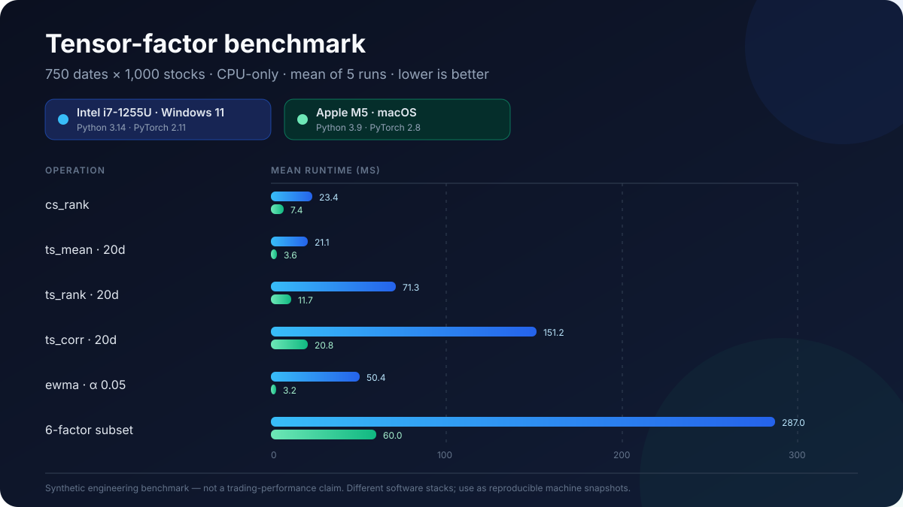

# Community Benchmark Board

This page tracks benchmark reports shared by users. Submit results with the
`Benchmark result` issue template.

For trading-workflow validation rather than tensor throughput, use
[`public_data_validation.md`](public_data_validation.md). That path reports
walk-forward baselines, transaction costs, slippage, turnover, and drawdown.
It also writes a copy-ready `submission.md` and machine-readable JSON files for
community reports.

## How to Submit

```bash
python -m pip install -e '.[dev]'
python scripts/benchmark_tensor_factors.py \
  --device cpu --n-dates 750 --n-stocks 1000 --window 20 \
  --repeat 10 --warmup 3 --threads 1 --interop-threads 1 --seed 42 \
  --json-out artifacts/benchmark-v1.json
```

Then open a benchmark issue, paste the printed Markdown table, and attach the
generated `artifacts/benchmark-v1.json`. `make benchmark` is an equivalent
shortcut on systems with GNU Make.

DeepSeek Harness users can use the
[`dsh-plugin-mlquant-benchmark`](https://github.com/initial-d/dsh-plugin-mlquant-benchmark)
helper and submit through the
[DSH benchmark report template](https://github.com/initial-d/ml-quant-trading/issues/new?template=deepseek_harness_benchmark.yml).
DSH reports should preserve the prompt, transcript or summary, JSON artifact,
and the same caveats as shell-only runs.

The command above is the canonical protocol v1 CPU run. It fixes the synthetic
panel at 750 dates x 1000 stocks, the 20-day window, seed 42, 3 warmups, 10
measured repetitions, and both PyTorch thread pools at one thread. Optional GPU,
larger-panel, and multi-thread runs should be reported separately.

For larger panels:

```bash
python scripts/benchmark_tensor_factors.py \
  --device auto \
  --n-dates 1500 \
  --n-stocks 3000 \
  --window 20 \
  --repeat 10 \
  --warmup 3 \
  --threads 1 \
  --interop-threads 1 \
  --seed 42
```

## Comparable Protocol v1 Results

| Contributor | Commit | OS | Python | PyTorch | Threads | CPU | GPU | Command | Notes |
|---|---|---|---|---|---:|---|---|---|---|
| Maintainer | `2765d19` | Windows 11 10.0.26200 | 3.14.4 | 2.11.0+cpu | 1 / 1 | Intel Core i7-1255U, 10 cores / 12 threads | none | `make benchmark` | CPU-only protocol v1 baseline |
| [@sergio12S](https://github.com/sergio12S) | `2a91c6b` | macOS 26.5.2 arm64 | 3.10.16 | 2.13.0 | 1 / 1 | Apple M4, 10 logical CPUs | none | canonical protocol v1 command in [issue #59](https://github.com/initial-d/ml-quant-trading/issues/59) | Community CPU report; `ts_corr` unstable across repeats |
| [@Angelo9up](https://github.com/Angelo9up) | `f8a48a3` | Windows 10 10.0.26200 | 3.11.4 | 2.14.0+cpu | 1 / 1 | Intel64 Family 6 Model 158 Stepping 11, 4 logical CPUs | none | canonical protocol v1 command in [issue #67](https://github.com/initial-d/ml-quant-trading/issues/67) | Community CPU report from a fresh main checkout |
| Maintainer via DSH | `960de19` | Windows 11 10.0.26200 | 3.14.4 | 2.11.0+cpu | 1 / 1 | Intel Core i7-1255U, 10 cores / 12 threads | none | DSH-assisted command in [issue #61](https://github.com/initial-d/ml-quant-trading/issues/61) | Agent-assisted seed report; high variance on `ts_corr` and `ts_rank` |

### Maintainer Protocol v1: Intel Core i7-1255U

Environment:

- Commit: `2765d19`
- Protocol: `v1`
- Machine: Intel Core i7-1255U, 10 cores / 12 threads
- OS: Windows 11 10.0.26200
- Python: 3.14.4
- PyTorch: 2.11.0+cpu
- PyTorch threads / interop threads: 1 / 1
- CUDA available: false
- Synthetic panel: 750 dates x 1000 stocks
- Window: 20
- Warmup / repeat: 3 / 10
- Seed: 42

| Device | Case | Mean | Std | Peak CUDA memory |
| --- | --- | ---: | ---: | ---: |
| cpu | `cs_rank(close)` | 77.4 ms | 2.8 ms | - |
| cpu | `ts_mean(close,20)` | 23.8 ms | 2.3 ms | - |
| cpu | `ts_rank(close,20)` | 76.1 ms | 11.1 ms | - |
| cpu | `ts_corr(close,returns,20)` | 152.3 ms | 9.2 ms | - |
| cpu | `ewma(close,0.05)` | 16.2 ms | 1.1 ms | - |
| cpu | `compute_legacy_set(6 factors)` | 551.0 ms | 45.9 ms | - |

This is the first comparable v1 report. Run the same command on another machine
and submit the complete output through the benchmark issue template.

### Community Protocol v1: Apple M4

Environment and raw results are preserved in [issue #59](https://github.com/initial-d/ml-quant-trading/issues/59).
This is a community-submitted, CPU-only protocol v1 report from a fresh checkout.
It is included for reproducibility and hardware context, not as a controlled
ranking against the maintainer result.

Environment:

- Contributor: [@sergio12S](https://github.com/sergio12S)
- Commit: `2a91c6b199d3f3608bbebacb36addb37949200b9`
- Protocol: `v1`
- Machine: Apple M4, 10 logical CPUs
- OS: macOS 26.5.2 arm64
- Python: 3.10.16
- PyTorch: 2.13.0
- PyTorch threads / interop threads: 1 / 1
- CUDA available: false
- Synthetic panel: 750 dates x 1000 stocks
- Window: 20
- Warmup / repeat: 3 / 10
- Seed: 42
- Exact command: the canonical protocol v1 command shown above

| Device | Case | Mean | Std | Peak CUDA memory |
| --- | --- | ---: | ---: | ---: |
| cpu | `cs_rank(close)` | 24.4 ms | 218.0 us | - |
| cpu | `ts_mean(close,20)` | 7.1 ms | 499.6 us | - |
| cpu | `ts_rank(close,20)` | 15.9 ms | 489.3 us | - |
| cpu | `ts_corr(close,returns,20)` | 36.9 ms | 4.7 ms | - |
| cpu | `ewma(close,0.05)` | 3.6 ms | 158.5 us | - |
| cpu | `compute_legacy_set(6 factors)` | 136.3 ms | 6.6 ms | - |

The contributor repeated the command on the same machine: `ts_corr` moved from
36.9 ms to 43.4 ms and its standard deviation rose from 4.7 ms to 12.1 ms,
while the other cases stayed within roughly 10%. The report also notes that a
historical `ts_rank` difference across commits is confounded by benchmark-script
and runtime changes. Keep both caveats attached to the numbers; do not infer a
PyTorch or hardware speedup from them.

### Community Protocol v1: Windows Intel64 Family 6 Model 158

Environment and raw results are preserved in [issue #67](https://github.com/initial-d/ml-quant-trading/issues/67).
This is a community-submitted, CPU-only protocol v1 report from a fresh main
checkout. It is included for reproducibility and runtime context, not as a
controlled ranking against other Windows reports.

Environment:

- Contributor: [@Angelo9up](https://github.com/Angelo9up)
- Commit: `f8a48a32f580a5514b27e0bc2220e5dfb75a3535`
- Protocol: `v1`
- Machine: Intel64 Family 6 Model 158 Stepping 11, GenuineIntel, 4 logical CPUs
- OS: Windows 10 10.0.26200
- Python: 3.11.4
- PyTorch: 2.14.0+cpu
- PyTorch threads / interop threads: 1 / 1
- CUDA available: false
- Synthetic panel: 750 dates x 1000 stocks
- Window: 20
- Warmup / repeat: 3 / 10
- Seed: 42
- Exact command: the canonical protocol v1 command shown above

| Device | Case | Mean | Std | Peak CUDA memory |
| --- | --- | ---: | ---: | ---: |
| cpu | `cs_rank(close)` | 115.3 ms | 23.0 ms | - |
| cpu | `ts_mean(close,20)` | 38.4 ms | 6.1 ms | - |
| cpu | `ts_rank(close,20)` | 109.1 ms | 11.9 ms | - |
| cpu | `ts_corr(close,returns,20)` | 150.7 ms | 17.3 ms | - |
| cpu | `ewma(close,0.05)` | 24.9 ms | 7.2 ms | - |
| cpu | `compute_legacy_set(6 factors)` | 659.8 ms | 10.8 ms | - |

The report states that PyTorch intra-op and inter-op thread counts were fixed at
one, no CUDA device was available, and no unusual thermal throttling,
shared-device load, or memory-limit conditions were observed.

### DSH Seed Protocol v1: Intel Core i7-1255U

Environment and raw results are preserved in [issue #61](https://github.com/initial-d/ml-quant-trading/issues/61).
This is a maintainer seed report produced through DeepSeek Harness. It is
included to verify the agent-assisted run, validation, and report path; it is
not an independent machine report or a controlled hardware ranking.

Environment:

- Contributor: Maintainer via DeepSeek Harness
- Commit: `960de1953f8589467456ad92bf9e4f978c3f0f1b`
- Protocol: `v1`
- Machine: Intel Core i7-1255U, 10 cores / 12 threads
- OS: Windows 11 10.0.26200
- Python: 3.14.4
- PyTorch: 2.11.0+cpu
- PyTorch threads / interop threads: 1 / 1
- CUDA available: false
- Synthetic panel: 750 dates x 1000 stocks
- Window: 20
- Warmup / repeat: 3 / 10
- Seed: 42
- Exact command: the DSH-assisted protocol command in issue #61

| Device | Case | Mean | Std | Peak CUDA memory |
| --- | --- | ---: | ---: | ---: |
| cpu | `cs_rank(close)` | 209.5 ms | 33.4 ms | - |
| cpu | `ts_mean(close,20)` | 37.6 ms | 6.1 ms | - |
| cpu | `ts_rank(close,20)` | 177.3 ms | 61.0 ms | - |
| cpu | `ts_corr(close,returns,20)` | 295.8 ms | 151.5 ms | - |
| cpu | `ewma(close,0.05)` | 51.7 ms | 9.0 ms | - |
| cpu | `compute_legacy_set(6 factors)` | 756.9 ms | 131.5 ms | - |

The report records the DSH prompt, the corrected command after an accidental
trailing argument, the generated JSON artifact path, and caveats. Treat the
numbers as evidence that DSH can preserve the benchmark workflow and artifact
boundary, not as a performance claim.

## Full Factor Streaming: Apple M5 (2026-10-25)

`iter_legacy_factors` supports per-factor screening/incremental storage without
retaining a `[T,N,213]` tensor. Source `7b90abf`, Apple M5 / macOS 26.6.2,
Python 3.12.14 / PyTorch 2.14.1, synthetic 750 x 1000, seed 42, threads 1/1,
1 warmup / 3 repeats, separate subprocesses, default `unfold` backend.
Both methods compute all 213 neutralized factors and reduce each to mean/RMS.

| Materialization | Median compute + reduction | Peak process RSS |
|---|---:|---:|
| Stack all factors | 5.314 s | 2649.0 MB |
| Consume/discard one factor | 4.450 s | 1391.2 MB |

**47.5% less process RSS and 16.3% shorter elapsed time for this screening
workload.** All 213 factor byte hashes and the joint mask agreed. Consumers
retaining every result lose this benefit; this is not model-training or alpha
evidence. RSS includes interpreter/allocator caching. Source/environment, exact
command, all timing samples and hashes: [raw JSON](benchmarks/factor-streaming-20261025/report.json),
[run output](benchmarks/factor-streaming-20261025/run.txt),
[local checks](benchmarks/factor-streaming-20261025/local-checks.json),
review [PR #81](https://github.com/initial-d/ml-quant-trading/pull/81).

## Integrated Block Moments: Apple M5 (2026-10-25)

Synthetic CPU evidence at code commit `2620ac1`, Apple M5 / macOS 26.6.2,
Python 3.12.14 / PyTorch 2.14.1, threads 1/1, seed 42, 2 warmups / 5 repeats.
The factor APIs and CLI now select `rolling_backend="linear"` explicitly;
the default remains `unfold`. Disjoint FP64 block moments repair past-outlier
cancellation found during full-engine integration.

| Complete 213-factor panel | Unfold / linear median | Unfold / linear peak process RSS |
|---|---:|---:|
| 500 x 200 | 0.541 / 0.816 s | 617.1 / 593.3 MB |
| 750 x 1000 | 4.706 / 6.818 s | 2648.4 / 2100.4 MB |

**The large full engine used 20.7% less process RSS but 45% more elapsed time.**
All individual factor masks agreed and outputs were finite; 41 factors had a
maximum valid difference above 1e-5. Nonlinear ranks can change materially
(`old_071` sampled mean Spearman 0.9770). Backend selection changes numerical
semantics; it is not a signal-equivalent acceleration. A separate 252-day
correlation kernel improved 7.44x with 81.8% less RSS on the finite-normal panel;
20-day kernels were slower. RSS includes interpreter/allocator caches.
[Raw results, commands, oracle diagnostics and preserved pre-fix failure](benchmarks/factor-backends-20261025/README.md)
are reviewable in [PR #81](https://github.com/initial-d/ml-quant-trading/pull/81).
No market data, predictive-quality or GPU-throughput claim.

## Historical Global-Prefix Rolling Moments: Apple M5 (2026-10-24)

Synthetic CPU systems evidence, separate from protocol v1 and trading quality.
At commit `f767f5c`, `ts_mean_linear`, `ts_std_linear`, `ts_cov_linear` and `ts_corr_linear`
use centred float64 prefix sums with O(T*N) arithmetic/storage, without a window
dimension. Existing factor functions remain the default. Masked/nonfinite values
are excluded; the first window-1 rows are invalid and partial observation counts
follow mean/sample-moment conventions.
These measurements predate the block-moment repair above and do not describe
the current implementation.

| Kernel | Window | Unfold median | Linear median | Speedup | Unfold peak RSS | Linear peak RSS |
|---|---:|---:|---:|---:|---:|---:|
| mean | 20 | 5.59 ms | 5.42 ms | 1.03x | 320.5 MB | 290.5 MB |
| mean | 60 | 15.42 ms | 5.44 ms | 2.83x | 427.4 MB | 290.5 MB |
| mean | 252 | 47.88 ms | 5.06 ms | 9.47x | 760.9 MB | 292.6 MB |
| corr | 20 | 26.68 ms | 13.78 ms | 1.94x | 513.6 MB | 328.3 MB |
| corr | 60 | 72.56 ms | 13.74 ms | 5.28x | 941.8 MB | 328.3 MB |
| corr | 252 | 222.83 ms | 12.68 ms | 17.57x | 2283.3 MB | 327.2 MB |

This is one Apple M5, macOS 26.6.2 arm64, Python 3.12.14 / PyTorch 2.14.1 run
at code commit `f767f5c` (full SHA in JSON). Synthetic 750x1000 finite float32
panel, 10% missing, seed 42, CPU only, intra/inter-op threads 1/1, 2 warmups and
5 repeats. Each kernel/window gets a fresh subprocess. MB is decimal;
**RSS includes interpreter and allocator caching**, not just kernel allocations.
The 20-day mean has little speed benefit. Masks agreed; maximum valid-output
differences were 3.06e-5 for mean and 3.58e-7 for correlation. Independent sampled
float64 window oracles and unit tests cover precision, missing inputs and causality.
FP64 throughput on GPUs is unmeasured; long, strongly drifting series can still
suffer prefix-subtraction cancellation. No market data or cost/alpha claim.

```python
from mlquant.features import ts_corr_linear
correlation, valid = ts_corr_linear(close, volume, observation_mask, window=252)
```

```bash
python scripts/benchmark_rolling_moments.py --n-dates 750 --n-stocks 1000 \
  --windows 20,60,252 --repeat 5 --warmup 2 --seed 42 \
  --json-out artifacts/rolling-moments-20261024/report.json
```

Raw evidence: [JSON](benchmarks/rolling-moments-20261024/report.json),
[run output](benchmarks/rolling-moments-20261024/run.txt),
[figure](benchmarks/rolling-moments-20261024/window-sweep.svg).
Plot from JSON with `scripts/plot_rolling_moments.py --report REPORT --output FIGURE.png`
(optional `matplotlib`).

## Pre-Protocol Machine Snapshots

The following results predate protocol v1. They did not pin PyTorch thread pools
or software versions and therefore must not be used as a controlled CPU ranking.



| Contributor | Commit | OS | Python | PyTorch | CUDA | CPU | GPU | Command | Notes |
|---|---|---|---|---|---|---|---|---|---|
| Maintainer | `44c6777` | Windows 11 10.0.26200 | 3.14.4 | 2.11.0+cpu | unavailable | Intel Core i7-1255U, 10 cores / 12 threads | none | `python scripts/benchmark_tensor_factors.py --device auto --n-dates 750 --n-stocks 1000 --window 20 --repeat 5 --warmup 2` | CPU-only Windows report |
| Maintainer | `d3a99b6` | macOS 26.5.1 arm64 | 3.9.6 | 2.8.0 | unavailable | Apple M5, 10 cores, 32 GB RAM | none | `python scripts/benchmark_tensor_factors.py --device auto` | CPU-only report on MacBook Air |

### Maintainer CPU Baseline: Intel Core i7-1255U

Environment:

- Commit: `44c6777`
- Machine: Intel Core i7-1255U, 10 cores / 12 threads
- OS: Windows 11 10.0.26200
- Python: 3.14.4
- PyTorch: 2.11.0+cpu
- CUDA available: false
- CUDA version: unavailable
- Synthetic panel: 750 dates x 1000 stocks
- Warmup / repeat: 2 / 5

| Device | Case | Mean | Std | Peak CUDA memory |
| --- | --- | ---: | ---: | ---: |
| cpu | `cs_rank(close)` | 23.4 ms | 2.5 ms | - |
| cpu | `ts_mean(close,20)` | 21.1 ms | 1.7 ms | - |
| cpu | `ts_rank(close,20)` | 71.3 ms | 6.3 ms | - |
| cpu | `ts_corr(close,returns,20)` | 151.2 ms | 10.2 ms | - |
| cpu | `ewma(close,0.05)` | 50.4 ms | 15.6 ms | - |
| cpu | `compute_legacy_set(6 factors)` | 287.0 ms | 15.8 ms | - |

The Windows and macOS baselines use different Python and PyTorch versions and
unrecorded default thread settings. They are retained for provenance only.

### Maintainer CPU Baseline: Apple M5 MacBook Air

Environment:

- Commit: `d3a99b6`
- Machine: MacBook Air, Apple M5, 10 cores, 32 GB RAM
- OS: macOS 26.5.1 arm64
- Python: 3.9.6
- PyTorch: 2.8.0
- CUDA available: false
- CUDA version: unavailable
- Synthetic panel: 750 dates x 1000 stocks
- Warmup / repeat: 2 / 5

| Device | Case | Mean | Std | Peak CUDA memory |
| --- | --- | ---: | ---: | ---: |
| cpu | `cs_rank(close)` | 7.4 ms | 151.8 us | - |
| cpu | `ts_mean(close,20)` | 3.6 ms | 356.1 us | - |
| cpu | `ts_rank(close,20)` | 11.7 ms | 504.5 us | - |
| cpu | `ts_corr(close,returns,20)` | 20.8 ms | 618.6 us | - |
| cpu | `ewma(close,0.05)` | 3.2 ms | 87.9 us | - |
| cpu | `compute_legacy_set(6 factors)` | 60.0 ms | 807.6 us | - |

## What Makes a Good Benchmark Report

- The command is copy-pasted exactly.
- Protocol v1 is present in the environment table.
- Both PyTorch thread counts are recorded.
- The commit SHA is included.
- CPU and GPU names are included.
- CUDA availability is stated.
- The result table is pasted without editing numbers.
- Any unusual conditions are documented, such as shared GPU, thermal throttling, or low memory.

## Why This Helps

Benchmark reports help users answer practical questions:

- Does GPU help for my panel size?
- Which operations dominate runtime?
- Is performance sensitive to PyTorch or CUDA version?
- What hardware is enough for a student or research workflow?
